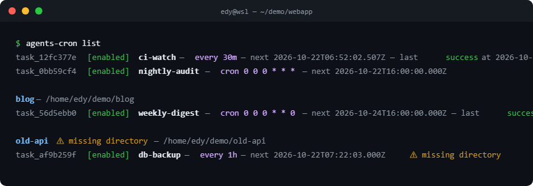
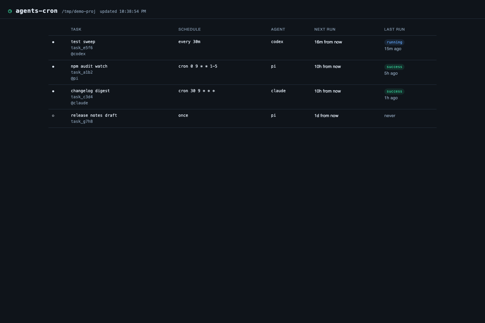

# agents-cron

Cron-driven scheduled prompt tasks for coding agents, with [Pi](https://pi.dev)
as the built-in agent.

Pi is the management surface; the `agents-cron` CLI is the execution surface. A
cron entry invokes `agents-cron run-due`, which drives each due task through an
**Agent Adapter** — the Pi adapter creates a fully isolated **Task Session** per
run. The plugin never schedules itself and never injects task output into your
interactive Pi session.

## Design

**Time is not ours.** The scheduler never wakes itself up: no timer, no daemon,
no long-running process. An external scheduler (cron) decides when to look, and
`run-due` answers one question — what is due *now*? — then exits.

**One run, one session.** Every Task Run gets a fresh, isolated session file.
Task output is never injected into your interactive session; `/schedule open`
prints the path so you can open it deliberately.

**The store is the only shared state.** Pi is the management surface and the CLI
is the execution surface, and they never call each other. They meet in
`<project>/.agents/cron/`, which is why Pi and cron can be set up in either
order, and why a scheduled run still works with Pi closed. The dashboard is a
third surface, and it only reads.

**Deciding is not executing, and neither is agent-specific.** The core owns
scheduling, storage, locking, and run records. An Agent Adapter owns exactly one
runtime. Adding an agent means adding an adapter directory and one
`registerAgent` line; the runner, store, CLI, and Pi surface stay untouched.

**Borrow the runtime instead of rebuilding it.** A Task Session is a real
headless run of the task's agent — `pi --print`, `claude --print`, or
`codex exec` — so the model, credentials, and project-trust rules are the ones
you already configured, not a second copy of an SDK that can drift.

**Ship what you run.** The published package contains the TypeScript sources it
executes. There is no build artifact that can go stale and no `dist/` that can
differ from the code you reviewed.

```text
  management surface (a Pi session)   execution surface (cron)
  ───────────────────────────────     ──────────────────────────────────
  /loop  /remind  /schedule           agents-cron run-due
  schedule_task tool                  │  acquires run.lock
        │ task-service                ▼
        │                             Task Runner
        │                             due filter · nextRunAt · stale reclaim
        │                             │  resolve (lazy)
        │                             ▼
        │                             Agent Registry → pi · claude · codex
        │                             │  spawn one headless agent run
        │                             ▼
        │                             one isolated Task Session per run
        │                             │
        ▼                             ▼
  ┌─────────────────────────────────────────────────────────────────────┐
  │  <project>/.agents/cron/     the only state the two surfaces share  │
  │  tasks.json   run.lock   runs/<runId>.json   sessions/<taskId>/…   │
  └─────────────────────────────────────────────────────────────────────┘
```

### Boundaries

| Component | Owns | Never does |
| --- | --- | --- |
| Task Runner (`src/runner.ts`) | due-ness, the run lock, run records, `nextRunAt` | schedule itself, import an agent SDK, know which agents exist |
| CLI (`src/cli.ts`) | argv → task service / runner, exit codes | manage your crontab, run an agent inline |
| Agent Registry (`src/agents/`) | agent id → adapter, loaded lazily | know how any agent actually runs |
| Agent adapters (`src/agents/*/adapter.ts`) | spawning the agent binary, the session record, runtime concerns | read or write the scheduler store |
| Pi surface (`src/agents/pi/`) | commands, the `schedule_task` tool, confirmations | schedule, lock, or execute anything |
| Store (`.agents/cron/`) | tasks, runs, sessions, the lock | hold run state inside `tasks.json` |

### Interactions

**cron → execution.** Cron runs `agents-cron run-due`. The Task Runner takes the
run lock, reclaims stale runs, filters tasks by `isDue`, and drives each one
through its adapter, which spawns one headless agent process. Each attempt
writes its own run record and advances `nextRunAt`. The lock covers the whole
pass, so a second invocation exits `0` reporting that another instance holds the
lock instead of queueing.

**Pi → management.** `/loop`, `/remind`, `/schedule …`, and the `schedule_task`
tool go through the task service into `tasks.json`. The extension is
deliberately inert inside a Task Session (see `AGENTS_CRON_TASK_SESSION`), so a
scheduled run cannot schedule more work — no accidental fan-out.

**Pi ↔ store ↔ CLI.** The two surfaces only ever meet in the store.
`/schedule run <id>` and `agents-cron run <id>` both execute the same task with
trigger `manual` and leave its schedule untouched.

## Features

- One-time, interval, and cron schedules
- One isolated Task Session per run, stored as its own session file
- Agent adapter layer: Pi, Claude Code, and Codex built in, new agents added without touching the core
- Local read-only dashboard for observing tasks and run history
- Global task registry (`~/.agents/cron/`) with project-local run artifacts — every task visible from any directory, its own project's tasks listed first
- Idempotent `run-due` with a project run lock and per-run records
- Crash recovery: stale runs are reclaimed on the next invocation
- Per-task and per-project configuration overrides
- Per-run Markdown reports next to the run records — what ran, how it went, where the transcript lives
- Agent tool plus slash commands for management, with argument completion: `/schedule ` suggests actions and real task/run ids, `/loop` suggests cron nicknames (`@daily`, …), and every creation command completes its trailing `--to <channel>` / `--notify <level>` flags from the project's notify config

## Install

```bash
# From npm (recommended)
pi install npm:agents-cron

# Or from a checkout
pi install .
```

Requires Node `>=22.19.0`. The package ships TypeScript and runs it as-is — no
build step, no `dist/`. Pi loads the extension through its own TypeScript
loader; the CLI registers a small loader hook of its own, because Node refuses
to strip types for files under `node_modules` (see [Development](#development)).

Previously published as `@fookhsu/pi-scheduler`. The rename is mechanical for
existing setups: the old package forwards to this one, the `pi-scheduler` bin
keeps working, and pre-rename `PI_SCHEDULER_*` environment variables are still
honored. Since 0.7.0 the store lives at `.agents/cron/` (was `.pi/scheduler/`);
the first run after upgrading copies it over automatically and leaves the old
copy in place, so crontabs and existing projects keep running untouched.

Since 0.9.0 task definitions live in the global registry at
`~/.agents/cron/tasks.json` (ADR 0007), bound to their project; run records
and sessions stay in each project's `.agents/cron/`. The first command that
touches a project imports its old `tasks.json` into the registry and renames
it aside — rolling back is renaming the file back and reinstalling 0.8.x.
Per-project crontab lines keep working as project-scoped passes; replace them
with the one global line when convenient.

Restart Pi or run `/reload` after installing. Installed with `pi install -l`,
the package is recorded in the project's `.pi/settings.json` instead of your
user settings.

## Cron setup

`run-due` is the only execution entry point, and the CLI never manages your
crontab. One global line drives every project's tasks (ADR 0007: task
definitions live in the machine-wide registry at `~/.agents/cron/`):

```cron
*/5 * * * * AGENTS_CRON_PI_BIN=/absolute/path/to/pi "$HOME/.pi/agent/npm/node_modules/.bin/agents-cron" run-due --all >> "$HOME/.agents/cron/cron.log" 2>&1
```

A project-scoped line (`cd /path/to/project && … run-due`) still works: it
runs only that project's due tasks, under the same per-project run lock, so
the two line styles cannot double-execute within one tick. Migrate old
per-project lines to the single global line when convenient.

Project installs put the binary at `.pi/npm/node_modules/.bin/agents-cron`
instead. If you linked it onto your `PATH`, plain `agents-cron` works.

Running a task spawns the `pi` executable, and cron starts jobs with a minimal
`PATH` that usually does not include it. Either set `PATH=` at the top of the
crontab, or point `AGENTS_CRON_PI_BIN` at `pi` — the command above does the
latter. A missing `pi` is reported on the run record, not silently skipped.
Tasks pinned to the Claude Code adapter spawn `claude` instead; the same
minimal-`PATH` rule applies, with `AGENTS_CRON_CLAUDE_BIN`.

## CLI

```text
agents-cron run-due [--project <path>|--all] [--agent <id>]   # cron entry point
agents-cron run <taskId> [--project <path>] [--agent <id>]
agents-cron list [--json]                              # current project first, then others
agents-cron show <taskId> [--json]                     # one task in full, prompt included
agents-cron add --prompt <text> (--at <iso>|--every <duration>|--cron <expr>) [--agent <id>] [options]
agents-cron enable <taskId> | disable <taskId> | remove <taskId>
agents-cron clear                                      # remove every task bound to the current project
agents-cron export [--out <file>] [--all] [taskId...]  # task definitions as JSON
agents-cron import <file> [--dry-run]                  # new tasks bind here, start disabled
agents-cron prune [--keep <n>]                         # all projects unless --project; default keep 20
agents-cron dashboard [--port <n>]                     # global, grouped by project
agents-cron migrate-sessions [--dry-run] [--project <path>]   # legacy transcripts into Pi's store
agents-cron test-notify [--channel <id>]
```

`--agent` selects the agent adapter (see [Agents](#agents)); it sets the task's
agent on `add` and the fallback agent on `run-due` and `run`.

Tasks live in the global registry, so `run`, `enable`, `disable`, and
`remove` act on any task from any directory; `add` binds the task to the
project it runs in (`--project` to bind elsewhere, `--cwd` to override only
the run's working directory). `list` prints one ordered list — the current
project's tasks first, then every other project grouped under a header, with
`⚠ missing directory` on tasks whose project has moved or vanished.

Exit codes: `0` success (including "no due tasks" and "another instance holds
the lock"), `1` at least one task failed, `2` configuration or storage error.

### Export and import

`export` writes a **Task Export**: a versioned JSON file of task definitions
and nothing else — no ids, no project bindings, no registry state or run
history. `import` turns each entry into a fresh task bound to the current
project, **disabled by default** (imported prompts will run with your
credentials — review, then `enable` each task). An entry is skipped as a
duplicate only when name, prompt, and schedule all match an existing task of
the project, so importing the same file twice adds nothing.

`export` prints to stdout (pipe it anywhere) or writes a file with `--out`;
`--all` spans every project for a whole-machine backup, and the file still
carries no paths — restoring on a new machine binds everything to the
directory you import from. `import --dry-run` prints the identical report
without writing.

### The global task list

Install the CLI once (`npm install -g agents-cron`) and it manages every
project's tasks from any directory. `list` prints one ordered view — the
current project's tasks first, then every other project grouped under a
header with its path spelled out. Tasks whose project moved or vanished stay
visible under a `⚠ missing directory` marker instead of disappearing:



`add` binds a task to the project it runs in (`--project` binds it elsewhere,
`--cwd` only overrides the run's working directory). `run`, `enable`,
`disable`, and `remove` accept any task id from any directory, and `run <id>`
executes with the owning project's lock, writing artifacts there. Full run
histories and session transcripts stay in each project's `.agents/cron/` —
the registry carries only definitions, scheduling state, and counters.
`show <taskId>` prints one task in full — project binding, schedule, run
counters, and the prompt verbatim — and accepts an id prefix like every
id-taking command.

## Dashboard

`agents-cron dashboard` serves a read-only web view of the same store the CLI
reads: every task with its next run, its latest outcome, per-task run history,
and each run's summary, error, and session record. Clicking a task opens its
detail panel, where a collapsed **show prompt** toggle reveals the stored
prompt behind the run history. It binds to `127.0.0.1`
only (default port 7383, `--port` to change), starts on demand, auto-refreshes
every few seconds, and stops with Ctrl-C. Because it never writes, it takes no
run lock and never interferes with cron's `run-due` — leave it open in a tab
all day if you like.



## Notifications

First-time setup is a guided wizard — `agents-cron setup-notify` opens the
mail and Feishu consoles for you, captures the SMTP authorization code and
bot webhook URL, writes the config, wires your shell and crontab, and
live-tests every channel.

Runs can announce themselves. Channels live in `.agents/cron/config.json`
(user-authored — `chmod 600` it, webhook tokens and SMTP hosts belong behind
file permissions), and by default only **failed** runs notify:

```json
{
  "version": 1,
  "notifications": {
    "on": "error",
    "channels": [
      { "id": "team", "type": "webhook", "url": "https://hooks.slack.com/services/…",
        "headers": { "Authorization": "Bearer …" } },
      { "id": "mail", "type": "email", "host": "smtp.example.com", "port": 465,
        "user": "cron@example.com", "from": "cron@example.com", "to": "you@example.com" }
    ]
  }
}
```

- `on` is the project default — `error` (default), `always`, or `never` — and a
  task overrides it with `notify` (`agents-cron add --notify always …`).
- A task can also **route** its notifications: `notifyTo` names the channel ids
  it announces on, and a task without it notifies every configured channel —
  unless the project sets a default route: `"defaultTo": ["feishu"]` applies to
  every task that names no channels of its own, and a task's `notifyTo` still
  wins. Route with `agents-cron add --notify-to feishu,mail …`, or in Pi with a
  trailing flag: `/remind in 45m review the release --to feishu --notify always`.
  Channel ids resolve against this project's config — an unknown id is warned
  about (at `add` time and at dispatch) and skipped, never fatal.
- Channels are optional: a run that would announce with none configured writes
  one reminder to stderr (which lands in the cron log) — nothing fails, no
  setup is forced. `agents-cron setup-notify` adds channels whenever you want
  them.
- **webhook** works with anything that accepts a POST: Slack, Lark, Discord,
  n8n, a home-rolled endpoint. The default body is JSON
  (`{source, project, task, run…}`); `format: "text"` posts the human summary.
- **system** shows the run as a desktop notification — macOS Notification
  Center (`osascript`, optional `sound`) or Linux `notify-send`. No external
  service needed, so it is the lightest way to make reminders perceptible:
  `{ "id": "mac", "type": "system", "sound": "Glass" }`.
- **email** speaks plain SMTP (Gmail, QQ, 163, self-hosted). The password
  comes from the environment, never the config file: `AGENTS_CRON_SMTP_PASSWORD`
  by default, or the channel's `passwordEnv`. The optional `nodemailer`
  dependency is loaded only when an email channel is configured.
- Delivery is best effort with a 10s budget per channel: a broken webhook
  prints one line to the cron log and never fails the run it reports on.
- `agents-cron test-notify` sends a sample run through every configured
  channel (or one, with `--channel <id>`) so the setup can be verified without
  waiting for a real failure.

## Pi commands

```text
/loop 30m check CI status
/loop "*/5 * * * *" check CI status
/loop @daily check CI status
/remind in 45m review the release
/remind at 15:30 check production
/schedule add 30m check CI status
/schedule add "0 9 * * 1-5" check CI status
/remind in 45m review the release --to feishu --notify always
/schedule add 30m check CI status --to feishu,mail
/schedule list
/schedule enable <id>
/schedule disable <id>
/schedule run <id>
/schedule remove <id>
/schedule runs <id>
/schedule open <runId>
/schedule export [file]              # definitions to agents-cron.tasks.json
/schedule export --all               # every project's definitions
/schedule import <file>              # new tasks here, disabled until enabled
/schedule clear
/schedule help
```

`/loop` and `/schedule add` take a schedule first: a duration (`30m`), a cron
nickname (`@daily`), or a cron expression in quotes. Quote an expression
whenever it contains spaces, otherwise its first field is read as the start of
the prompt. Nicknames are `@yearly`, `@annually`, `@monthly`, `@weekly`,
`@daily`, and `@hourly`.

`/loop`, `/remind`, and `/schedule add` also accept trailing flags after the
prompt: `--to <id,id>` routes the task's notifications to those channels, and
`--notify always|error|never` sets its level — so
`/remind in 45m review the release --to feishu --notify always` reaches you on
Feishu the moment the run finishes.

`/schedule open <runId>` prints the Task Session file path and suggests
`pi --session <path>`. Task Sessions are never merged into the current session.
`/schedule help` (or any unknown action) prints the full action list.

## Agent tool

The `schedule_task` tool supports `add`, `list`, `enable`, `disable`, `delete`,
`run`, `runs`, and `clear`. It is registered with `deferred` exposure: it stays
out of the resident tool manifest until the model finds it with pi's built-in
`tool_search`, which the extension activates on session start. On pi versions
without deferred exposure the tool simply registers as before.

```json
{
  "action": "add",
  "name": "check-ci",
  "prompt": "检查当前项目 CI 是否通过；如果失败请分析原因",
  "schedule": { "kind": "interval", "every": "30m" },
  "notify": "always",
  "notifyTo": ["feishu"]
}
```

`notify` sets the task's notification level and `notifyTo` routes it to named
channels from `.agents/cron/config.json`; both are optional and independent.

Deleting and clearing tasks requires interactive confirmation; creating a task does not. The `/schedule remove` and `/schedule clear` commands ask for the same confirmation.

## Configuration and overrides

Every `AGENTS_CRON_*` variable below also answers to its pre-rename
`PI_SCHEDULER_*` spelling; the new name wins when both are set.

A Task Session is an ordinary Pi session: it runs in the task's `cwd` (the
project root by default) and loads that project's settings, `AGENTS.md`, skills,
and extensions. You can override what it uses at two levels.

Because the Task Runner is invoked by cron, a Task Session is always headless:
it is a `pi --print` process, so it resolves project trust exactly like any
other non-interactive Pi run — the saved decision in `~/.pi/agent/trust.json`,
otherwise `defaultProjectTrust`, which leaves a project with project-local
resources untrusted. An untrusted project contributes no `.pi/settings.json`,
skills, prompts, or extensions to its Task Sessions; run `/trust` in that
project once (or set `defaultProjectTrust` to `"always"`) to change that.
`AGENTS.md` is not gated by project trust and loads either way.

Resolution order, highest priority first:

1. Per-task fields (`agent`, `model`, `thinking`, `cwd`, `tools`).
2. Project settings in `<project>/.pi/settings.json`.
3. User settings in `~/.pi/agent/settings.json`.

### Override a run with `.pi/settings.json`

Project settings merge over global settings, so a repository can pin the model
that scheduled work uses without touching your global default:

```json
{
  "defaultProvider": "deepseek",
  "defaultModel": "deepseek-v4-flash",
  "defaultThinkingLevel": "low"
}
```

The same file can disable scheduler resources for a project that should not run
scheduled tasks, using the package-filter object form:

```json
{
  "packages": [
    {
      "source": "npm:agents-cron",
      "extensions": [],
      "skills": []
    }
  ]
}
```

Project overrides only apply after the project is trusted; commit
`.pi/settings.json` to share them with your team. `pi config -l` opens the same
file in an editor with inherited global resources dimmed.

### Override one task

Any task can override the agent, model, thinking level, working directory, and
tool allowlist. In `.agents/cron/tasks.json`:

```json
{
  "id": "task_a1b2c3d4",
  "name": "daily-audit",
  "prompt": "检查 CI 并分析失败原因",
  "schedule": { "kind": "cron", "expression": "0 9 * * *" },
  "agent": "pi",
  "model": "anthropic/claude-opus-4-5",
  "thinking": "high",
  "cwd": "packages/api",
  "tools": ["read", "bash", "grep"],
  "enabled": true,
  "nextRunAt": "2026-09-11T09:00:00.000Z",
  "createdAt": "2026-09-10T09:00:00.000Z",
  "updatedAt": "2026-09-10T09:00:00.000Z"
}
```

`cwd` is resolved relative to the project root. Omitting a field falls back to
the project and user settings; omitting `tools` keeps the agent's default tool
set. Omitting `agent` uses the adapter that `run-due` selected (the built-in Pi
adapter by default).

The same overrides are available on the CLI and the Agent tool:

```bash
agents-cron add \
  --prompt "检查 CI 并分析失败原因" \
  --cron "0 9 * * *" \
  --agent pi \
  --model anthropic/claude-opus-4-5 \
  --thinking high \
  --cwd packages/api \
  --tools read,bash,grep
```

```json
{
  "action": "add",
  "prompt": "检查 CI 并分析失败原因",
  "schedule": { "kind": "cron", "expression": "0 9 * * *" },
  "agent": "pi",
  "model": "anthropic/claude-opus-4-5",
  "thinking": "high",
  "cwd": "packages/api",
  "tools": ["read", "bash", "grep"]
}
```

## Agents

The scheduler core — scheduling, storage, locking, run records — never imports
an agent SDK. Running a task goes through an **Agent Adapter**: a small object
that knows how to drive one Task Run in a concrete runtime.

```ts
export interface AgentAdapter {
  readonly id: string;          // e.g. "pi"
  readonly displayName: string;
  run(request: AgentRunRequest): Promise<AgentRunResult>;
}
```

Adapters register lazily, so an unused agent runtime is never loaded. Adding an
agent means adding `src/agents/<id>/adapter.ts` and one `registerAgent` line in
`src/agents/builtin.ts`; the runner, CLI, storage, and Pi surface stay
untouched. The Pi adapter lives in `src/agents/pi/` together with the Pi
extension, tools, and slash commands.

The Pi adapter drives a Task Run by spawning `pi --print --session <file>` in the
task's `cwd`, and reports the printed answer as the run summary. It imports no
Pi SDK, so a Task Run works from a bare `node` process — which is what cron is.
The spawned `pi` is also the runtime that owns the model, credentials, and
project-trust rules, so a scheduled run behaves like any other non-interactive
Pi run. The only requirement is that `pi` be reachable: see
[Configuration and overrides](#configuration-and-overrides) and
`AGENTS_CRON_PI_BIN`.

### Claude Code

The Claude Code adapter drives a Task Run by spawning
`claude --print --output-format json` in the task's `cwd`, and records the JSON
result — final message, Claude Code session id, usage — as the run's session
record at `.agents/cron/sessions/<taskId>/<runId>.json`. Claude Code keeps its
own transcript; `claude --resume <session_id>` reopens it.

Two behavior differences from the Pi adapter:

- A headless Claude Code run cannot approve permission prompts, so a tool the
  task did not allow is denied, not asked. Set `tools` on tasks that need to
  write or execute: the task's tool list maps to `--allowedTools`.
- `thinking` has no Claude Code equivalent and is ignored.

The `claude` binary is resolved like `pi`: `AGENTS_CRON_CLAUDE_BIN` first,
then `$PATH`. Pin it in the crontab the same way.

Pi remains the management surface: `/schedule`, `/loop`, and `/remind` still
manage the same store, and `schedule_task` gains an `agent` field to pin a task
to a specific adapter.

### Codex

The Codex adapter drives a Task Run by spawning
`codex exec --json --skip-git-repo-check --output-last-message <tmp>` in the
task's `cwd`, and records exit code, final message, and the JSONL event tail as
the run's session record at `.agents/cron/sessions/<taskId>/<runId>.json`.
Codex keeps its own transcript under `~/.codex/sessions/`.

Two behavior differences from the other adapters:

- A task without `tools` runs in a `read-only` sandbox; a task with any `tools`
  runs `workspace-write`. Codex has no per-tool allowlist — `codex exec` fixes
  its approval policy at "never", so the sandbox decides what a headless run
  may touch, and it can never block on an approval prompt.
- `thinking` has no Codex equivalent and is ignored.

The `codex` binary is resolved like the others: `AGENTS_CRON_CODEX_BIN` first,
then `$PATH`. Pin it in the crontab the same way.

Pi remains the management surface: `/schedule`, `/loop`, and `/remind` still
manage the same store, and `schedule_task` gains an `agent` field to pin a task
to a specific adapter.

## Storage and recovery

```text
~/.agents/cron/                       # the global Task Registry (ADR 0007)
├── tasks.json                        # version 2: every task + scheduling state, 0600
├── registry.lock                     # short-lived registry write lock, 0600
└── cron.log                          # redirect target for the global crontab line

<project>/.agents/cron/               # run artifacts, one store per project
├── config.json                       # optional notification channels (user-authored)
├── run.lock                          # project-wide run lock, 0600
├── runs/<runId>.json                 # one record per run, 0600
├── reports/<taskId>/<runId>.md       # per-run Markdown report, 0600
├── sessions/<taskId>/<runId>.jsonl   # the Task Session, forced to 0600
└── tasks.json.imported.<ts>          # a migrated pre-0.9 store, kept for rollback
```

Both directories should be gitignored (the registry is never inside a repo;
add `.agents/cron/` for the project store — other tools may commit their own
`.agents/` entries such as `skills/`). Every scheduler file, including Task
Session JSONL files, is written with `0600` permissions. `AGENTS_CRON_HOME`
relocates the global registry for tests and non-default homes.

### Task Sessions in Pi's session store (opt-in)

By default the Task Session stays in the private layout above. Set
`AGENTS_CRON_PI_STORE=1` for the `pi` adapter to place each run's transcript
in **Pi's own default session store** instead —
`<agentDir>/sessions/--<encoded-cwd>--/<taskId>-<runId>.jsonl` — so scheduled
runs appear in `pi --continue` pickers and pi-web's project session lists
like any interactive session. The file is still one fresh, isolated session
per run; only its location changes. `PI_CODING_AGENT_DIR` and
`PI_CODING_AGENT_SESSION_DIR` relocations are honored, keeping Pi, pi-web,
and the scheduler on the same paths.

Run records always carry the transcript's absolute path (`sessionFile`), so
`/schedule open`, the dashboard, and future layouts need no reconfiguration:
reads follow the record, not the layout. This variable is newer than the
rename, so — unlike the variables above — it has no `PI_SCHEDULER_*` spelling.

To carry transcripts that already exist into the store, run
`agents-cron migrate-sessions` (`--dry-run` first to preview). It moves each
pi transcript to the directory Pi uses for the cwd the run actually worked
in — taken from the transcript's own session header — rewrites the run
record, keeps `0600` permissions, never overwrites an existing file, and
refuses to run while another instance holds the run lock. Other agents'
transcripts stay where they are; a second pass is a no-op.

- A task stores a prompt and a time rule, never a shell command, and is bound
  to its project (`projectDir`): artifacts, run lock, and notification config
  all follow the binding.
- Scheduling state (`nextRunAt`, counters, `lastStatus`) lives only in the
  registry; the project store is append-only artifacts. A crash may lose one
  run record, never re-execute a task.
- A project still carrying a pre-registry `tasks.json` is migrated lazily on
  the next command that touches it; the old file is renamed aside, and
  rollback is renaming it back.
- `run-due` takes each project's `run.lock` in turn, executes that project's
  due tasks serially, and advances `nextRunAt` from the current time. Missed
  recurring periods collapse into one catch-up run.
- A one-shot task is terminal after its first attempt: success disables it,
  failure does not retry, and a run that passed the grace window (default 5
  minutes) is recorded as `missed` and needs `run <id>`.
- A task whose project directory is gone errors in the registry (visible in
  `list` as `⚠ missing directory`), stays enabled, and — when recurring —
  moves to its next occurrence instead of erroring every tick.
- A run still marked `running` after the timeout (default 30 minutes) is
  reclaimed as `error` on the next invocation.
- Every terminal run — success, error, or missed — also writes a Markdown
  report (`reports/<taskId>/<runId>.md`): metadata, the full summary, the
  error, and a link to the session transcript. Reports are pruned together
  with their run records.

## Development

```bash
npm install
npm run check    # typecheck + tests (includes a packed-tarball smoke test)
```

There is no build. `npm run typecheck` runs `tsc --noEmit`, and `npm test` runs
the suite with Node's own test runner against the same `.ts` sources the
package ships.

Two loaders run those sources, which is the whole packaging story:

- **Extension** — `pi` compiles the extension itself through jiti. The manifest
  entry is the root `index.mjs`, a three-line re-export of
  `src/agents/pi/extension.ts`. The `index` basename is load-bearing: pi's
  compact label logic only drops the file path for entries named `index.*`,
  so this naming is what keeps the extensions list showing just
  `agents-cron` while the real code stays next to its commands, tools, and
  env pieces. A CI gate in `tests/packaging.test.ts` enforces it.
- **CLI** — cron starts `bin/agents-cron.mjs` with a bare `node`, and Node
  explicitly refuses to strip types for files under `node_modules`, which is
  where an installed package lives. The entry registers `bin/ts-loader.mjs`, a
  hook scoped to this package's own `.ts` files and nothing else.

Stripping is a whitespace-preserving strip, so the sources must stay erasable
(no enums, no parameter properties). `erasableSyntaxOnly` in `tsconfig.json`
enforces that at typecheck time, which is what keeps the missing build step
from becoming a runtime surprise.

`tests/packaging.test.ts` packs the tarball, installs it into a temp
directory, and runs the installed CLI with a bare `node` — the one test that
exercises the `node_modules` path the loader exists for.

`src/agents/` is the agent adapter layer: `types.ts` is the adapter contract,
`registry.ts` resolves adapters, `builtin.ts` wires the built-ins, and each
agent (`pi/`, `claude/`, `codex/`) holds everything agent-specific; nothing
under `src/agents/pi/` except its adapter is imported by the CLI path, and the
adapters spawn the agent binary rather than linking an SDK.
Everything else in `src/` is agent-agnostic: the Task Runner, stores, locking,
and CLI.

## Releasing

The package follows the [Pi package](https://pi.dev/docs/latest/packages)
conventions: the `pi-package` keyword and a `pi` manifest in `package.json`.

```bash
npm run check        # typecheck + tests
npm pack --dry-run   # inspect the published file list
npm publish          # prepublishOnly re-runs check
```

`files` ships `assets/`, `bin/` (entry points and the TS loader), `src/` (the
sources that actually run), and `skills/`. Nothing is compiled, so what
`npm pack` lists is what executes on install. `@earendil-works/pi-coding-agent`
stays an optional peer: only the extension imports it, and Pi hands its own
copy to extensions, so an install of the scheduler never needs a second SDK.

## License

[AGPL-3.0](LICENSE) — GNU Affero General Public License v3.0.
